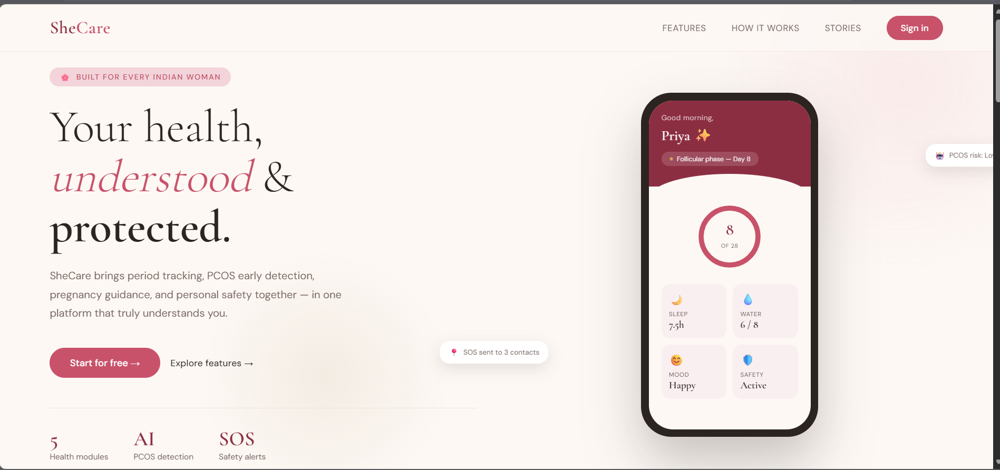

 <div align="center">


# 💜 SheCare — Women's Health & Safety Platform

**A technology-driven platform designed to support women's health, wellness, and safety.**

[](https://shecare-platform-g8bpqewmn-divya-alats-projects.vercel.app)
[](https://nextjs.org/)
[](https://www.mongodb.com/)
[](https://vercel.com/)

</div>

---

## 🌸 About the Project

**SheCare** is a women's health and safety platform designed to bring essential wellness resources and health-support features together in one place.

The project focuses on menstrual health tracking, PCOS risk awareness, pregnancy-related information, lifestyle guidance, emergency safety support, and AI-assisted health information.

Its goal is to make women's health resources more accessible through a user-friendly digital experience.

> 💜 Built with empathy, powered by technology.

## ✨ Key Features

| Feature | Description |
|---|---|
| 🩸 **Period Tracker** | Helps users record menstrual cycles, monitor symptoms, and view estimated upcoming periods. |
| 🔬 **PCOS Risk Awareness** | Supports health-input-based risk awareness. It is not a medical diagnostic tool. |
| 🤰 **Pregnancy Guide** | Provides pregnancy-related information and guidance, depending on the implemented functionality. |
| 🆘 **Safety SOS** | Intended to support emergency alerts and location sharing where implemented and configured. |
| 🧘 **Lifestyle & Wellness** | Offers wellness information and lifestyle suggestions to support everyday wellbeing. |
| 🤖 **AI Health Chatbot** | Designed to help users explore women's health questions and general health information. |

*Note: Feature descriptions should reflect what is currently functional in the source code. Remove or label any planned features that are not yet implemented.*

## 🛠️ Technology Stack

| Technology | Purpose |
|---|---|
| **Next.js** | Web application framework |
| **JavaScript** | Application logic and interactivity |
| **MongoDB** | Database, where configured |
| **CSS3** | Styling and responsive interface |
| **Vercel** | Application deployment |

## 🚀 Live Demo

Explore the deployed application:

**[Open SheCare →](https://shecare-platform-g8bpqewmn-divya-alats-projects.vercel.app)**

The deployed experience may differ from the latest local development version.

## 📸 Screenshots

Add screenshots of the current application to help visitors understand its interface and functionality.

Once you have verified that these image files exist in the repository, you can use:

| Page | Image |
|---|---|
| Home Page | `homepage.png` |
| AI Chatbot | `chatbot.png` |
| Period Tracker | `tracker.png` |
| PCOS Risk Assessment | `pcos.png` |

For example, if `homepage.png` is stored in the repository root:

```markdown

```

Use the correct filename and folder path for each screenshot. Remove any image that does not exist.

## ⚙️ Getting Started

Follow these steps to run the project locally.

### Prerequisites

- Node.js and npm
- Git
- MongoDB connection, if required by the current implementation

### 1. Clone the repository

```bash
git clone https://github.com/Divya-alat/SheCare-Platform.git
```

### 2. Open the project directory

```bash
cd SheCare-Platform
```

### 3. Install dependencies

```bash
npm install
```

### 4. Configure environment variables

Create a `.env.local` file in the project root and add the environment variables required by your application.

For example, if your code uses MongoDB:

```env
MONGODB_URI=your_mongodb_connection_string
```

Add any additional variables required by your actual implementation. Keep API keys, database credentials, and other secrets private; never commit them to GitHub.

### 5. Start the development server

```bash
npm run dev
```

Open [http://localhost:3000](http://localhost:3000) in your browser.

**Troubleshooting:** If the project does not start, check the scripts in `package.json` and the environment variables required by the application.

## 🎯 Project Goals

- Make women's health information easier to access.
- Encourage awareness of menstrual and reproductive health.
- Provide accessible wellness resources.
- Explore how AI can support health-information discovery.
- Bring health and safety-related tools into a unified user experience.

## 🔭 Future Enhancements

Potential improvements include:

- 📱 A mobile application.
- ⌚ Integration with supported wearable devices.
- 👩‍⚕️ Links to qualified healthcare professionals and reliable resources.
- 🌐 Multilingual accessibility.
- 📊 Enhanced health-data visualization and analytics.
- 🔐 Further improvements to data privacy and security.

These are future possibilities, not claims of currently implemented functionality.

## 🩺 Health & Safety Disclaimer

SheCare is an informational and educational project. It is not a substitute for professional medical advice, diagnosis, or treatment.

PCOS-related risk assessments and AI-generated responses must not be treated as confirmed diagnoses. Users should consult qualified healthcare professionals for medical concerns. Emergency SOS or location-sharing features should not be relied upon as a guaranteed emergency-response service.

## 👩‍💻 Developer

<div align="center">

**Divya Alat**

E&TC Engineering Graduate | Software Development | Embedded Systems & IoT

Pune, Maharashtra, India

[](https://github.com/Divya-alat)
[](https://www.linkedin.com/in/divyaalat/)
[](mailto:divyaalat1711@gmail.com)

</div>

---

<div align="center">

### ⭐ Support the Project

If you find SheCare interesting, consider starring the repository and sharing your feedback.

**Built with 💜 to support women's health and wellbeing.**

</div>
